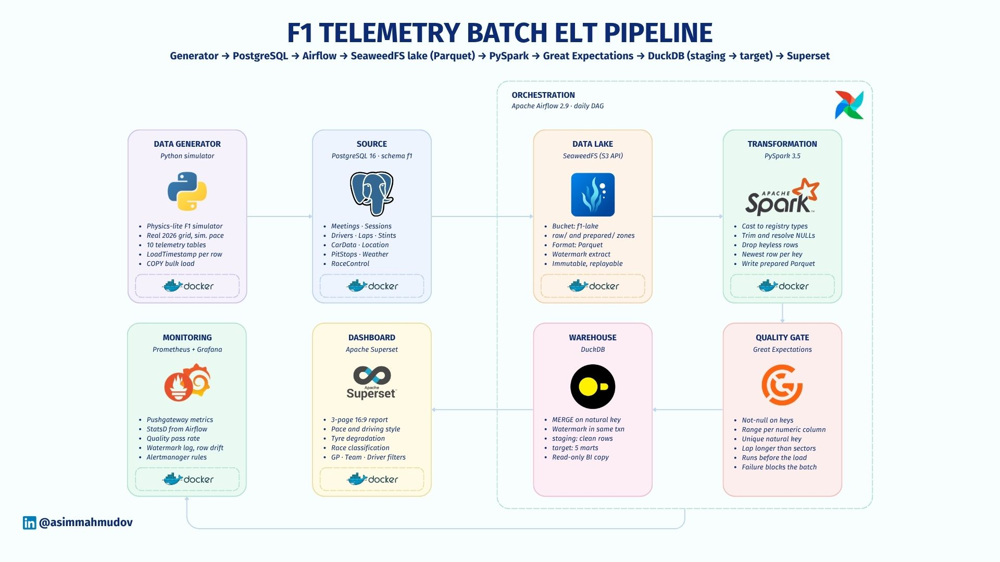
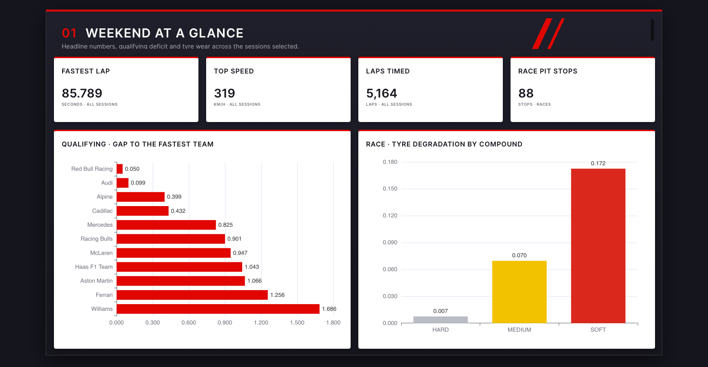
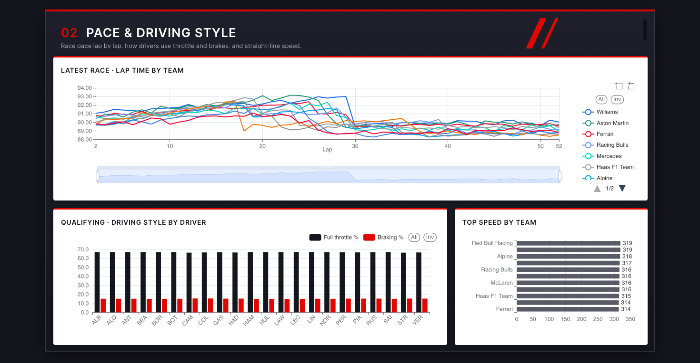
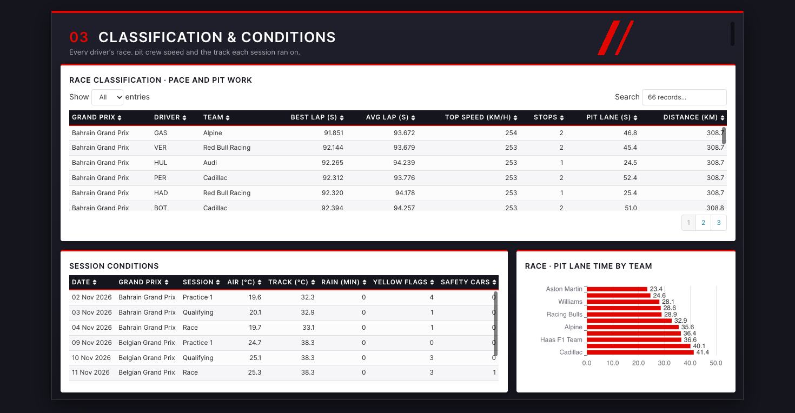

# F1 Telemetry Batch ELT Pipeline

A daily batch pipeline that moves Formula 1 timing and car telemetry from a
PostgreSQL source into a DuckDB warehouse. A Great Expectations check sits in
front of the warehouse, and a Superset report reads the result. Everything runs
locally in Docker.



## Contents

1. [Tech stack](#tech-stack)
2. [Run it step by step](#run-it-step-by-step)
3. [The report](#the-report)
4. [The data](#the-data)
5. [How it works](#how-it-works)
6. [Project structure](#project-structure)
7. [Tests](#tests)
8. [Troubleshooting](#troubleshooting)
9. [Notes](#notes)

## Tech stack

| Layer | Tool | What it does here |
|---|---|---|
| Data generator | Python | Simulates race weekends into the source |
| Source | PostgreSQL 16 | 10 telemetry tables in schema `f1` |
| Orchestration | Apache Airflow 2.9 | One daily DAG, one mapped task per table |
| Data lake | SeaweedFS (S3 API) | Parquet files in `raw/` and `prepared/` zones |
| Transform | PySpark 3.5 | Cast types, trim text, de-duplicate |
| Quality gate | Great Expectations 0.18.19 | Stops a bad batch before it loads |
| Warehouse | DuckDB | `staging` (clean rows) and `target` (5 marts) |
| BI | Apache Superset 4.0 | A three-page report with filters |
| Monitoring | Prometheus, Grafana, Alertmanager | Rows loaded, pass rate, watermark lag, alerts |

## Run it step by step

You need Docker Desktop (or Docker Engine with Compose v2), `make`, `git` and
Python 3 (only used to generate `.env`). Commands below run from the
project folder.

### Step 1. Clone the repository

```bash
git clone https://github.com/asimmakhmudov/f1-telemetry-pipeline.git
cd f1-telemetry-pipeline
```

### Step 2. Give Docker enough memory

In Docker Desktop open Settings → Resources → Advanced, set Memory to at least
5 GB and Swap to 4 GB, then click Apply & restart. The stack is sized for an 8 GB
laptop. `docker info | grep "Total Memory"` should now show about 4.8 GiB.

### Step 3. Create the `.env` file

```bash
make env
```

This copies `.env.example` to `.env` and fills every blank value: default
usernames, plus random passwords and secret keys. The template in git holds no
credentials. Your `.env` is git-ignored, and it is where you look up the logins
for the apps below. To see them:

```bash
grep -E '_(USER|PASSWORD)=' .env
```

### Step 4. Start the core services

```bash
make up
```

The first build takes 5 to 10 minutes. Later starts take seconds, and running it
again is safe. Check that everything is up:

```bash
docker compose ps
```

`airflow`, `airflow-scheduler`, `airflow-db`, `source-db`, `lake` and
`statsd-exporter` should be `healthy`. The one-off jobs `airflow-init` and
`lake-init` exit when done; `docker compose ps -a` shows them as `Exited (0)`.

### Step 5. Create the schemas and tables

```bash
make bootstrap
```

Creates the `f1` schema, its 10 tables and a read-only role in PostgreSQL, plus
the DuckDB warehouse with its `etl`, `staging` and `target` schemas. Safe to re-run.

### Step 6. Generate source data

```bash
make seed
```

Writes 3 race weekends (one a week, the last one today) at 2 samples per second
in about 25 seconds. That is roughly 1 million rows each in `CarData` and
`Location` and about 5,000 laps. For more data: `make seed MEETINGS=5 HZ=3.7`.

### Step 7. Run the pipeline

```bash
make dag-test
```

Runs the whole DAG once and prints the logs: extract, Spark, quality checks,
load, marts and reconciliation. It takes about a minute, and the last line should
say `state=success`. Running it again is safe and adds no duplicates.

To run it through the Airflow scheduler instead and watch it in the UI:

```bash
make run
```

### Step 8. Check the results

```bash
docker compose exec airflow python -m tasks.watermark show
make warehouse Q='SELECT * FROM target.team_session_pace ORDER BY "GapToFastest" LIMIT 10'
```

`watermark show` should list all 10 tables with status `SUCCESS`, and the
`reconcile_counts` task in the DAG log should report a drift of 0 per table.

Open the apps in your browser:

| App | URL | Login |
|---|---|---|
| Airflow | <http://localhost:8080> | `AIRFLOW_ADMIN_USER` / `AIRFLOW_ADMIN_PASSWORD` |
| Lake file browser | <http://localhost:8888/buckets/f1-lake/> | none |
| PostgreSQL source | `localhost:5433`, database `f1_telemetry` | `SOURCE_DB_USER` / `SOURCE_DB_PASSWORD` |

The logins are the values in your `.env`. The source listens on port 5433 because 5432 is often taken by a local
PostgreSQL. To open a SQL prompt without installing anything:

```bash
docker compose exec source-db psql -U f1_owner -d f1_telemetry
```

Table and column names are mixed case, so quote them: `SELECT count(*) FROM f1."Laps";`.
pgAdmin, DBeaver and TablePlus connect with the values in the table above.

### Step 9. Open the Superset report

```bash
make bi           # start Superset (wait about a minute)
make bi-import    # load the committed dashboard from bi/export/
```

Go to <http://localhost:8088> (log in with `SUPERSET_ADMIN_USER` / `SUPERSET_ADMIN_PASSWORD`) and open Dashboards → F1 Telemetry.
`make bi-build` rebuilds the dashboard from `bi/build_dashboard.py` instead, and
`make bi-export` saves your changes back to `bi/export/` for git.

### Step 10. Start monitoring (optional)

```bash
make monitoring
```

Grafana is at <http://localhost:3000> (log in with `GRAFANA_ADMIN_USER` / `GRAFANA_ADMIN_PASSWORD`) with the F1 telemetry
pipeline dashboard. Alertmanager is at <http://localhost:9093>. On an 8 GB machine,
run either Superset or monitoring, not both.

### Step 11. Watch the quality gate stop bad data

```bash
make corrupt      # makes one lap's first sector longer than the whole lap
make dag-test     # validate_batch fails for Laps; the other tables still load
```

The marts that read `Laps` keep their previous version and the others refresh.
To recover, fix the row in PostgreSQL and run
`docker compose exec airflow python -m tasks.watermark reset Laps`, or reset
everything (Step 12).

### Step 12. Stop or reset

```bash
make down     # stop all containers, keep the data
make reset    # stop and delete all data volumes
```

After `make reset`, start again from Step 4.

### All make targets

| Command | What it does |
|---|---|
| `make env` | Create `.env` with generated logins and keys |
| `make up` | Build and start the core services |
| `make bootstrap` | Create schemas, tables and the control table |
| `make seed` | Generate race weekends into PostgreSQL |
| `make dag-test` | Run the full DAG once, in-process |
| `make run` | Unpause and trigger the DAG in Airflow |
| `make warehouse Q='...'` | Run a SQL query against DuckDB |
| `make bi` / `bi-import` / `bi-build` / `bi-export` | Superset and its dashboard |
| `make monitoring` | Start Prometheus, Alertmanager and Grafana |
| `make corrupt` | Insert a bad row to demo the quality gate |
| `make test` / `test-container` / `lint` | Tests and linting |
| `make down` / `make reset` | Stop, or stop and delete all data |

## The report

The Superset dashboard has three pages, each sized as a 16:9 slide. Grand Prix,
Team and Driver filters sit above the pages, and clicking a bar or a table row
filters the rest of the page. All numbers are simulated (see [The data](#the-data)).

**Page 1, weekend at a glance.** Headline numbers, qualifying gap to the fastest
team, and tyre wear per compound.



**Page 2, pace and driving style.** Lap time by team through the latest race,
full-throttle and braking share per driver, and top speed by team.



**Page 3, classification and conditions.** Every driver's race, track conditions
per session, and average pit-lane time by team.



## The data

The source follows the shape of the public F1 live-timing feeds (OpenF1, FastF1).
A meeting is a race weekend with three sessions: Practice 1, Qualifying and Race.

| Table | Grain | What it holds |
|---|---|---|
| `Meetings` | race weekend | circuit, country, length |
| `Sessions` | session | name, type, start and end, scheduled laps |
| `Drivers` | driver per session | number, acronym, team, team colour |
| `CarData` | 2 to 4 samples a second per car | speed, RPM, gear, throttle, brake, DRS |
| `Location` | same clock as `CarData` | X/Y/Z position on track |
| `Laps` | lap | lap and sector times, speed traps, pit-out flag |
| `Stints` | tyre stint | compound, first and last lap |
| `PitStops` | pit stop | pit-lane time and stationary time |
| `Weather` | minute | air and track temperature, humidity, wind, rain |
| `RaceControl` | message | flags, safety car, DRS, track limits |

`generator/generate.py` is a small simulator. Each circuit gets a speed profile
from its corners, and lap times come from driver and team pace, tyre compound and
wear, fuel load and safety cars. Team, driver and circuit names are the real 2026
grid and calendar. Every lap time, speed and result is made up.

The five marts in `target`:

| Mart | Grain | Answers |
|---|---|---|
| `lap_telemetry` | driver lap | speed, full-throttle %, braking %, DRS %, gear changes |
| `driver_session_summary` | driver session | best and average lap, top speed, pit stops |
| `stint_performance` | tyre stint | average pace and degradation per lap |
| `session_conditions` | session | weather, rain minutes, yellow flags, safety cars |
| `team_session_pace` | team session | best lap and gap to the fastest team |

## How it works

1. **Extract only new rows.** Each source row has a `LoadTimestamp`, and
   `etl.LoadControl` stores the last one loaded per table. A run reads rows above
   that watermark, plus a 5 minute overlap to catch late commits.
2. **Keep raw history.** Each extract writes one Parquet file to
   `raw/<table>/dt=<date>/batch=<window>.parquet` and never rewrites it. The file
   name comes from the time window, so re-running a window gives the same file.
3. **Clean with Spark.** Cast to the declared types, trim text, drop rows without
   a key and keep the newest row per natural key. The output goes to `prepared/`.
4. **Check before loading.** Great Expectations validates the prepared batch:
   non-null keys, a range per numeric column, unique keys, and rules such as "a
   lap is longer than any of its sectors". If it fails, the batch is not loaded
   and the watermark stays put, so the same rows are retried next run.
5. **Load without duplicates.** The batch is merged into `staging` on the natural
   key, and the watermark moves in the same transaction. Both commit or neither does.
6. **Rebuild the marts.** Each `target` mart is one SQL `SELECT` over `staging`,
   applied with a MERGE that also removes stale rows.
7. **Reconcile and publish.** Row counts are compared between source and staging,
   metrics go to Prometheus, and a read-only copy of DuckDB is published for Superset.

Adding a source table means a row in `etl.LoadControl` plus its DDL, registry
entry and expectation suite. The DAG reads the table list at run time.

## Project structure

```
.
├── assets/                  architecture diagram and report screenshots
├── bi/                      Superset report builder, export/import script, exported YAML
├── dags/                    Airflow DAG (wiring only)
├── docker/                  Airflow and Superset images, Superset colour palettes
├── expectations/            one Great Expectations suite per staging table
├── generator/               F1 telemetry simulator that fills the source
├── monitoring/              Prometheus, Alertmanager, StatsD mapping, Grafana dashboard
├── scripts/                 init_env.py, which creates .env for `make env`
├── sql/
│   ├── bootstrap.py         creates every schema and table
│   ├── source/              PostgreSQL DDL for the f1 schema
│   ├── warehouse/           DuckDB DDL for etl, staging and target
│   └── target/              one SELECT per mart
├── tasks/                   pipeline logic: extract, transform, validate, load, marts
│   └── tables.py            column, type and key registry everything is derived from
├── tests/
│   ├── unit/                run without Docker
│   └── integration/         need the running stack
├── .github/workflows/       CI: lint and unit tests on every push
├── .env.example             configuration template (no credentials)
├── docker-compose.yml
├── Makefile
├── pyproject.toml
└── requirements.txt
```

## Tests

The tests use a local Python 3.11 environment, separate from Docker. Spark needs
Java 17; on macOS the tests find an installed Java 17 on their own.

```bash
uv venv --python 3.11 .venv
uv pip install --python .venv/bin/python -r requirements.txt
source .venv/bin/activate

make test             # 233 passed, 1 skipped (the DAG test needs Airflow)
make test-container   # full suite inside the Airflow image: 240 passed
make lint             # ruff and black
```

If you use conda, run `conda deactivate` first so its Python does not shadow the
project's. CI runs lint and the unit tests on every push.

## Troubleshooting

| Problem | Fix |
|---|---|
| A container shows `Exited (137)` | It ran out of memory. Close other apps, or set `SPARK_DRIVER_MEMORY=768m` and `DUCKDB_MEMORY_LIMIT=768MB` in `.env`, then `make up`. |
| A task failed | Open its log in Airflow (click the red box, then Logs), or run `docker compose logs airflow`. |
| `lake-init` did not complete | Run `docker compose logs lake-init`. "already exists" is fine. "cannot connect to master" means `lake` is not healthy yet; run `make up` again. |
| Port already in use | Something else uses 5433, 8080, 8088, 8333, 8888 or 3000. Stop it, or change the left-hand port in `docker-compose.yml`. |
| pgAdmin shows no `f1` schema | You connected to a local PostgreSQL. Use port 5433. |
| Spark tests fail with `getSubject is not supported` | Spark started on Java 18+. Install Java 17. |
| Changed the generator and re-seeded | The warehouse never deletes rows, so run `make reset` and start from Step 4. |

## Notes

- This is a batch pipeline. Streaming live timing would need a message broker and
  a streaming engine, which is out of scope.
- DuckDB is embedded, with no server or port. Only one process can write to it, so
  the tasks that open it share a single-slot Airflow pool and Superset reads a copy.
- Spark is more than this data size needs; DuckDB alone could do the cleaning. It
  is here because a full season at the real ~4 Hz across every car would need it,
  and the same DataFrame code would run on a cluster unchanged.
- A watermark cannot see deletes in the source. The reconcile step compares row
  counts after each run, and the `RowCountDrift` alert fires when they differ.
- All performance data is synthetic. Driver, team and circuit names are real, but
  no real timing data is used anywhere.
